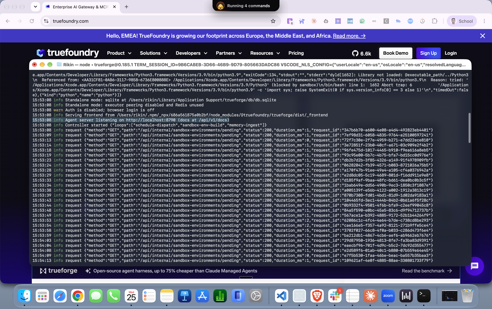
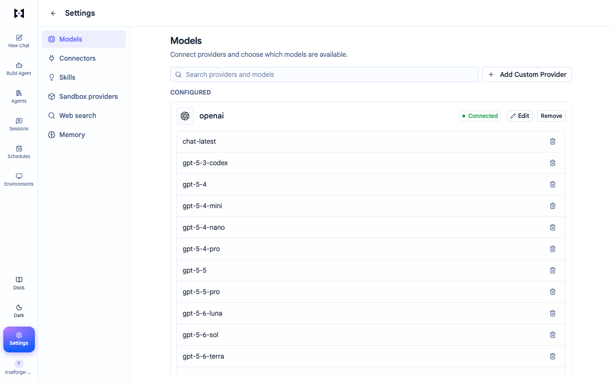
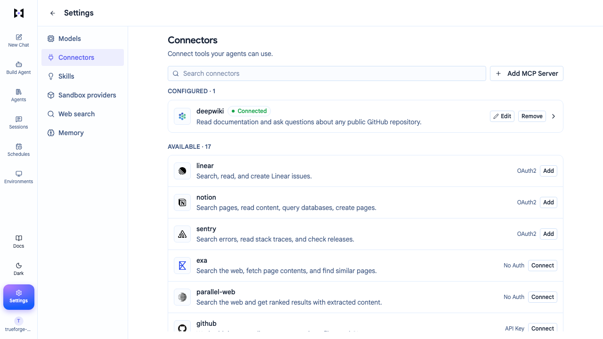
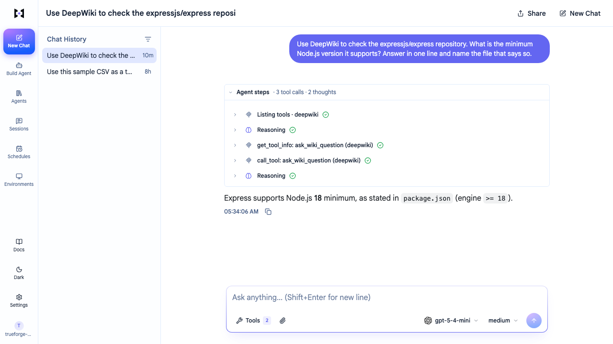
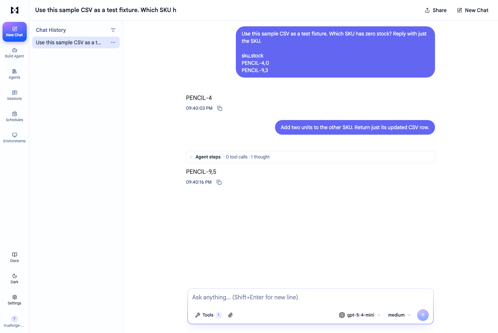
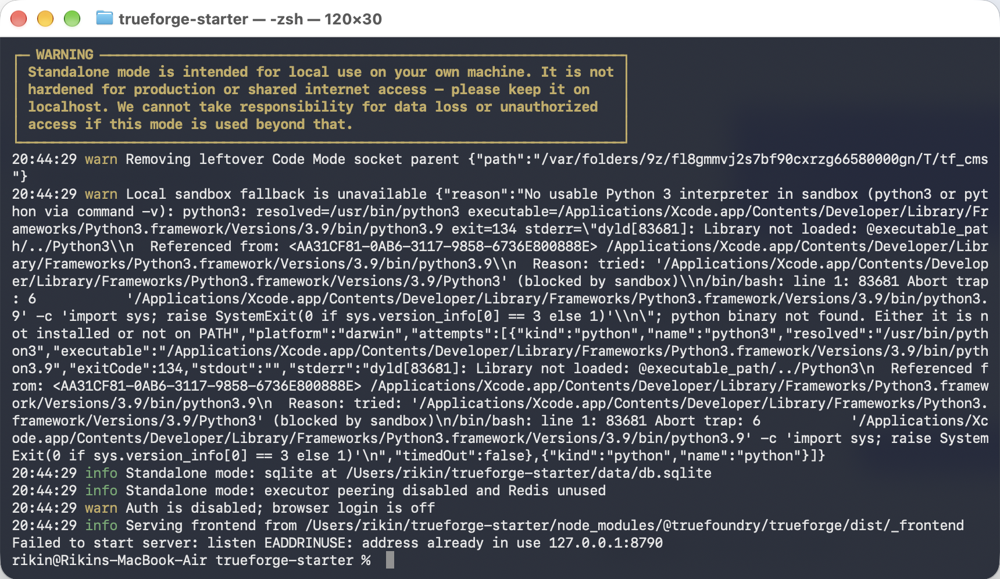

# Getting started with TrueForge in 10 minutes

*Run an open-source agent with one command, watch it choose its own tools, and see exactly what each answer costs.*

By Rikin Shah · Tested November 23, 2026 with TrueForge 0.185.1

<!-- layout: truefoundry -->

Most agent demos stop at a chatbot. You type, it answers, and you could have done the same thing in ChatGPT. The part worth your time is when the agent decides on its own to go and fetch something, and you can see every step it took and what it cost.

That's where this guide gets you. TrueForge is TrueFoundry's open-source agent harness: the layer between your chat window and the model that keeps the conversation, runs the tools, and saves everything to disk. It runs anywhere Node.js does, on macOS, Linux or Windows, with your own model key. Ten minutes from now you'll have watched it answer a question about a GitHub repo by calling three tools it picked itself, for about a third of a cent.

I ran every step on my MacBook. The commands, outputs, timings and costs below come from that run, not from the docs.

### TL;DR

- **One command** starts TrueForge at `localhost:8790`. No project setup.
- **One click** connects DeepWiki, a tool that reads public GitHub repos. No account needed.
- **One question** made the agent call 3 tools on its own. I checked its answer and it was right.
- **It's cheap, but tools aren't free.** The tool answer cost $0.0033 and took 21 seconds. A plain answer cost $0.0005 to $0.0012 and took about 2 seconds.

## Is this for you?

**Good fit:** developers who want to try agents and MCP tools on their own machine before building anything. Also anyone who wants one chat window that works with OpenAI, Anthropic, Gemini or any OpenAI-compatible endpoint, with the history kept in a file they own.

**Not a good fit:** if you just want to talk to an AI, ChatGPT or Claude.ai is less work. No terminal, no API key, no per-token bill. And local mode is for one person. It has no login, and TrueForge prints a warning at startup that it isn't hardened for shared or internet access.

## Before you start

- **Node.js 22.14 or newer** on any computer. Run `node --version` to check. If it's missing, get the installer from nodejs.org. It comes with npm and `npx`.
- **An API key** from any model provider. I used OpenAI.
- **Ten minutes.**

## 1. Start TrueForge

Open a terminal and run one command.

```bash
npx @truefoundry/trueforge@0.185.1
```

In plain terms:

- `npx` downloads a tool and runs it straight away. Nothing gets installed for the whole computer, and there's no project folder to set up.
- `@truefoundry/trueforge` is TrueForge's package name.
- `@0.185.1` pins the exact version I tested. Leave it off to get the latest release.

When you see this line, it's ready.

```text
Agent server listening on http://localhost:8790 (docs at /api/v1/docs)
```



Leave the terminal open and go to [localhost:8790](http://localhost:8790). Two things the defaults handle for you:

- **It only listens on your own computer.** `localhost` means other devices on your Wi-Fi can't reach it. That matters, because local mode has no login.
- **Your chats go in one database file** in your user's app-data folder. On my Mac that was `~/Library/Application Support/trueforge/db/db.sqlite`. The startup line beginning `Standalone mode: sqlite at` shows the exact path on your machine.

You'll also see a yellow warning box about local use, and possibly a long line starting `Local sandbox fallback is unavailable`. Both are expected. I come back to the second one under "What I'd watch out for".

## 2. Connect a model

A fresh install opens on **Settings → Models**. Find your provider's row, click **Configure**, paste your key, and click **Create**. When it says **Connected**, you're done.



## 3. Give the agent a tool

This is the step that makes TrueForge more than a chat window.

Go to **Settings → Connectors**. There are 18 ready-made connectors, including GitHub, Linear, Notion and Sentry. Most need a login. **DeepWiki** doesn't, and it answers questions about any public GitHub repo, so it's the quickest one to try. Click **Connect**.



Now click **New Chat**. Under the message box, open **Tools**, go to the **Connectors** tab, and tick **deepwiki**. Pick your model (I used **gpt-5-4-mini**, which is how TrueForge lists OpenAI's gpt-5.4-mini) and ask something you'd normally dig through a repo to find out.

```text
Use DeepWiki to check the expressjs/express repository. What is the minimum Node.js version it supports? Answer in one line and name the file that says so.
```

21 seconds later:

```text
Express supports Node.js 18 minimum, as stated in package.json (engine >= 18).
```

Click **Agent steps** above the reply. That panel is the reason to use a harness.



The model never touched DeepWiki itself. It asked TrueForge what tools were available, then asked for the details of one called `ask_wiki_question`, then asked TrueForge to call it on `expressjs/express`. TrueForge ran each request and handed back the result. Three tool calls, and the model chose every one.

Notice that TrueForge didn't give the model DeepWiki's full tool manual up front. The model had to ask for the list, and then for one tool's details. With one connector that hardly matters. With ten, it keeps the model from paying to read descriptions of tools it will never use.

I didn't take the answer on trust. `npm view express engines` printed `{ node: '>= 18' }`, so it was right. The [tool-call log](evidence/macbook-run/deepwiki-turn-events.json) shows every request and response.

## 4. Check what it remembers

Start a new chat, without DeepWiki this time, and send this.

```text
Use this sample CSV as a test fixture. Which SKU has zero stock? Reply with just the SKU.

sku,stock
PENCIL-4,0
PENCIL-9,3
```

It replied `PENCIL-4`. Then send a follow-up that only makes sense if it remembers the rows.

```text
Add two units to the other SKU. Return just its updated CSV row.
```

It replied `PENCIL-9,5`. The follow-up never names the SKU or its starting stock, so the model must have received the first message again. TrueForge sends the whole conversation every time. The [turn records](evidence/macbook-run/new-chat-turns.json) show each turn pointing back at the one before.

Then I asked "where is the csv stored?" The model said it "isn't stored anywhere persistent". That's wrong. The rows are sitting in TrueForge's SQLite file on my disk. The model only knows what's in the conversation. Remembering is TrueForge's job, and the model can't see that it happened.

## 5. Restart and get it all back

Press **Ctrl+C** in the terminal, then run the same command again.

```bash
npx @truefoundry/trueforge@0.185.1
```

Reload [localhost:8790](http://localhost:8790), open the chat that starts **Use this sample CSV** under **Chat History**, and everything is still there.



If the restart fails with `Failed to start server: listen EADDRINUSE: address already in use`, an older TrueForge is still running, probably in another terminal tab. That happened to me.



Think of port 8790 as a parking spot that only one program can use at a time. The old TrueForge is still parked there, so the new one has nowhere to go. On macOS or Linux, these two lines find the old one and stop it:

```bash
lsof -nP -iTCP:8790 -sTCP:LISTEN
kill -INT $(lsof -t -iTCP:8790 -sTCP:LISTEN)
```

- **The first line asks your computer which program is using port 8790.** If the COMMAND column says `node`, that's TrueForge. The PID column is the ID number your computer gave it.
- **The second line looks up that same ID and tells the program to stop.** `-INT` sends the same signal as Ctrl+C. Your chats are already saved, so nothing is lost.

Then start it again. If **Chat History** comes back empty, compare the `Standalone mode: sqlite at` line from both starts. They should print the same path.

## What it costs, and how fast it is

Here are the three answers from this guide, priced at OpenAI's published rates for gpt-5.4-mini: $0.75 per million input tokens, $0.075 per million cached input tokens, and $4.50 per million output tokens. Each one ran once, so read them as ballpark figures, not a benchmark.

| | CSV question | CSV follow-up | DeepWiki question |
| --- | --- | --- | --- |
| Time | 2.4 seconds | 2.3 seconds | 21 seconds |
| Model calls | 1 | 1 | 4 |
| Input tokens | 1,516 | 1,545 (1,408 cached) | 7,042 (4,608 cached) |
| Output tokens | 19 | 57 | 260 |
| Cost | $0.0012 | $0.0005 | $0.0033 |

Three things stand out.

**The tool answer cost more and took longer.** It was a different question, so this isn't a clean comparison, but the reason is easy to see. Every tool call is another round trip. The model sends its request, TrueForge runs the tool, and the result goes back to the model with the conversation so far. That's where the extra 18 seconds and 5,500 tokens came from. Even so, a thousand DeepWiki questions like this one would cost about $3.34 on this model. Finding a repo's Node version by hand takes longer than 21 seconds.

**The follow-up was the cheapest answer, even though it sent more tokens.** OpenAI charges a tenth of the price for input it has seen recently. TrueForge resends the conversation in the same order every time, so 1,408 of the follow-up's 1,545 input tokens hit that discount. On long chats, that adds up.

**The model matters more than the tool.** gpt-5.4 costs $2.50 per million input tokens, more than three times the mini model's price. Choose the cheapest model that gets the job right, and switch on only the connectors a chat needs.

Those are single questions. For bigger jobs, the harness itself starts to move the bill. TrueFoundry ran 14 multi-step tasks across three MCP servers on the same model (Claude Opus 4.8) in three harnesses. These are their numbers, not mine:

| Harness | Cost per run | Tokens per run |
| --- | --- | --- |
| TrueForge | $8.50 | 3.8M |
| Claude Managed Agents | $11.80 | 10M |
| deepagents | $21.00 | 16.5M |

According to their [comparison post](https://www.truefoundry.com/blog/best-open-source-agent-harness), accuracy was roughly a tie, because the model sets the ceiling. What differed was how much each harness re-sent on every step. Swapping TrueForge to GLM-5.2 brought it down to $2.90 per run. Their numbers come from TrueFoundry testing its own product, so read the methodology before you lean on them.

## What I'd watch out for

- **Code execution was off on my Mac.** TrueForge's local sandbox needs a real Python 3. On a Mac, `/usr/bin/python3` is Apple's Xcode stub, so the sandbox wouldn't start. Nothing in this guide runs code, but agents that write and run their own scripts will need more setup. I haven't tested whether installing Python fixes it.
- **There's no login in local mode.** Keep the default `localhost`. Don't open the port to your network.
- **The model doesn't know what the harness does.** It said my CSV wasn't stored when it was. Ask TrueForge's screens, logs and API what happened, not the model.
- **It's young.** TrueFoundry's own comparison calls TrueForge "the youngest project" in its list and says its third-party ecosystem is thin next to opencode's.

## Where to go next

- **Just exploring?** Try another no-login connector. **exa** and **parallel-web** add web search, and both are marked **No Auth** in Connectors.
- **Have a task you repeat every week?** Give the agent a job, not a question. Connect GitHub, Linear, Notion or Sentry, ask it to do the lookup you do by hand, and time both.
- **Need it for a team?** Local mode isn't that. According to TrueFoundry, there's a documented path to Docker Compose and Helm with login. I haven't tried it.

*Tested on a MacBook (macOS 27.2.1, Apple silicon) with Node.js 26.13.0 and gpt-5.4-mini. Prices from OpenAI's gpt-5.4-mini model page, checked November 23, 2026. The [run notes](evidence/macbook-run/README.md) have the raw logs.*

## Learn more

- [TrueForge initial setup guide](https://trueforge.dev/harness/initial-setup): model providers, MCP servers, memory, skills and sandbox providers.
- [Best open source agent harness: top 5 compared](https://www.truefoundry.com/blog/best-open-source-agent-harness): how TrueForge stacks up against opencode, Pi, OpenHands and deepagents.
